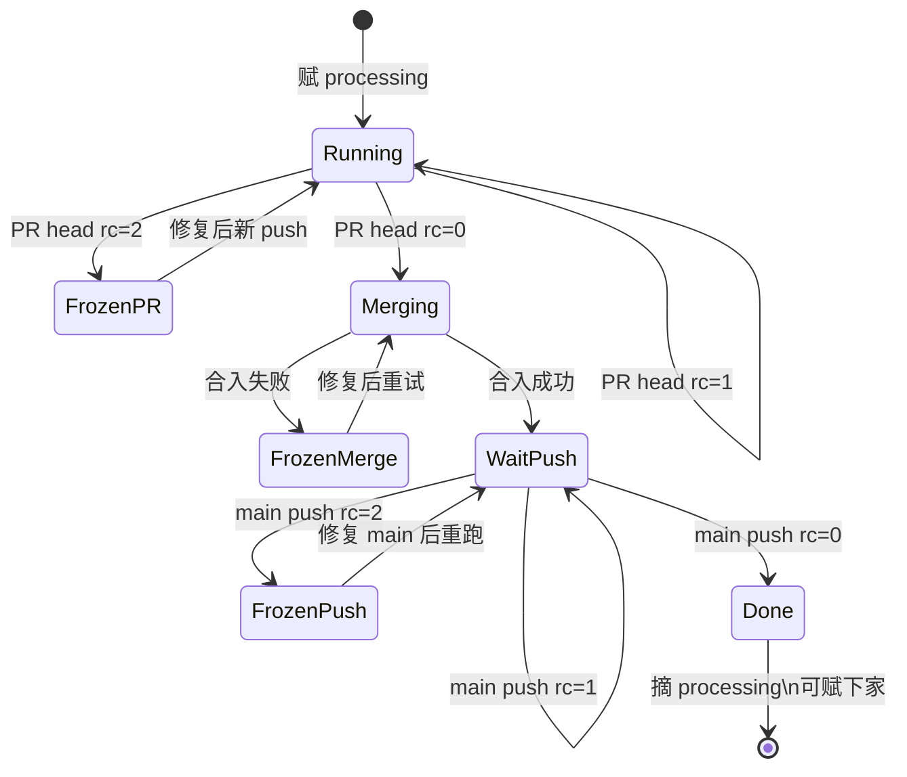

# `processing` 标签队列（PR Queue Controller）

控制面脚本：`scripts/pr_queue_controller.sh`  
触发 workflow：`.github/workflows/pr-queue-controller.yml`（**只 checkout default branch**，不执行 PR head 代码）。

## 权威交付语义对照（#359）

| # | 用户语义 | 实现 | 对齐 |
|---|----------|------|------|
| 1 | 全仓唯一 `processing`，占位跑 PR 检查 | 至多一标；pve PR job 门控 `processing`；`fetch_processing_labeled_prs --state all` | **已覆盖** |
| 2 | PR 三门绿 → squash；合不了冻队 | `advance_all_green_queue_head` + `attempt_squash_merge`；失败 `QUEUE_HEAD_NUM` 保留标 | **已覆盖** |
| 3 | 合进 main 不算结束；main 本次合入检查全绿才摘标 | `wait_main_push_then_maybe_release` 盯 merge commit 的 `substrate-gate-suite` + `quality-gate` | **已覆盖**（见下「代理判据」） |
| 4 | 失败 / 合入失败不放通道 | PR head `rc=2`、合入失败、main push `rc=2` 均保留 `processing` | **已覆盖** |
| 5 | `queue-jump` 不抢占、消费标、多插队 FIFO | `pick_next_processing_candidate` + `assign_processing_to_pr` | **已覆盖** |
| 6 | 主流程先 1–4，插队为预留 | 无 jump 时 assign 纯 FIFO | **已覆盖** |

**代理判据（非偏差）**：main push 交棒未逐条扫全部 check-runs，而是 `quality-gate` + `substrate-gate-suite`；push 上 QG 内部已等 `ci-ok`+substrate（见 `quality-gate.yml`），与「本次合入触发的 main CI 腿」等价。

**已知偏差 / 流程外**：见 [pr-queue-adversarial-review.md](./pr-queue-adversarial-review.md)「交付设计缺口」。

## 一句话

全仓同时最多一个 PR 持有 `processing`（**仅由 PR Queue Controller 自动维护**）。正常路径 **零人工贴/撕标**：`pull_request_target` + `workflow_run`（CI/QA/Droid/QG）+ **schedule** 驱动 reconcile → 自动赋标 → 三门绿 squash → 等 merge commit 上 main push 绿 → 自动摘标 → 赋下一家。`queue-jump` 仅紧急显式插队；人手改 `processing` 是 **break-glass**，非交付路径。

槽位释放条件：**squash 合入 main 成功**，且 merge commit 上 **main push** 的 `substrate-gate-suite` + `quality-gate` 均已 success——在此之前下一个 PR 不会拿到 `processing`。

## 流程结束 ≠ PR 三门全绿

| 阶段 | `processing` | 下一 PR 能否开跑 |
|------|----------------|------------------|
| PR head 检查未齐 | 保留 | 否 |
| PR head 三门全绿 | 保留（尝试合入） | 否 |
| 合入失败（conversation/冲突等） | **保留（冻队）** | 否 |
| 合入成功，main push CI 未齐 | **保留**（挂在已 MERGED 的 PR 上） | 否 |
| merge commit 上 push 检查全绿 | **摘掉** | 是 |
| main push 检查失败 | **保留（冻队）** | 否 |

避免：PR 刚绿就摘标 → 下一 PR 占 pve，同时 main push 也在跑 → runner 冲突。

## 谁能拿 `processing`？

必须同时满足：

| 条件 | 说明 |
|------|------|
| 非 draft | |
| 非 fork | |
| 无 `do-not-merge` | |
| 当前 head **尚未**三门全绿 | 全绿 PR 不回到 assign 队列（防 #358 回贴） |

槽位空出后赋标顺序：

1. 带 `queue-jump` 的 PR（彼此之间仍按创建时间 FIFO）
2. 其余 PR 按创建时间 FIFO

**不抢占**：已有队首持有 `processing` 时，插队标只影响下次赋标顺序；**绝不**撕掉他人 `processing`。队首可仅有 `processing`，插队 PR 可仅有 `queue-jump`，两标可并存于不同 PR。

### `queue-jump`

人工/自动化贴 `queue-jump`；槽位空出时优先于 FIFO；赋 `processing` 时消费；ineligible 或 head 已三门全绿时过期摘掉。

**标签前提（一次性）**：`processing` / `queue-jump` 须在仓库存在（**本 PR 合入 main 后**跑 **Setup Labels** 或等价建标）。之后 **仅 reconcile 写标**，用户不必 `gh pr edit`。

**首次上线**：reconcile 脚本来自 **default branch**；本套规则随 #359 **合入 main 后**生效，此后全自动。合入前 main 上旧控制器行为可能不同，不靠人工撕标，靠合入后 schedule/workflow_run 收敛。

## PR head 三门（合入前）

`substrate-gate-suite`、`quality-gate`、`droid-review`（Dependabot 可豁免 droid-review）。对 **当前 head commit** 查 check-runs。

### `required_checks_rc`（PR head）

| rc | 队首行为 |
|----|----------|
| 0 | 进入 **合入 + 等 main push** 路径（`advance_all_green_queue_head`） |
| 1 | 保持 `processing` |
| 2 | 保持 `processing`，**冻队** |

## 合入后：main push（`main_push_checks_rc`）

合入成功后 **不立即摘标**。在 **merge commit**（`mergeCommit.oid`）上等待：

- `substrate-gate-suite`
- `quality-gate`

（push→main 不跑 `droid-review` / PR 专用 QA，故不在此集合。）

| rc | 行为 |
|----|------|
| 0 | `release_processing_slot` — 流程结束，可赋标下一 PR |
| 1 | 保持 `processing`（等 CI workflow_run / schedule 再 reconcile）；**reconcile job 成功退出**（pending/skip 不算 workflow 失败） |
| 2 | 保持 `processing`，**冻队** |

已 MERGED 但仍带 `processing` 的 PR 通过 `gh pr list --label processing --state all` 追踪（open 列表里已不存在）。

## 凭证（workflow）

| 用途 | Token | 说明 |
|------|--------|------|
| 读 check-runs、改 label、发评论 | `github.token` | workflow `GH_TOKEN` 传给脚本第 2 参数 |
| `gh pr merge --squash` | `secrets.DISPATCH_TOKEN` | 脚本第 3 参数 `GH_MERGE_TOKEN`；**禁止**退回 GITHUB_TOKEN（push 事件被抑制，main 永不跑 substrate/quality） |
| Secret 缺失 | — | workflow **fail-loud** 退出，不静默 reconcile |

与 [auto-merge.yml](../../.github/workflows/auto-merge.yml) 同一 PAT 铁律。仓库须已配置 `DISPATCH_TOKEN`（见 `docs/onboarding/consumer-onboarding.md`）。

脚本 `log()` 只写 **stderr**，避免 `pick_next_processing_candidate` / `choose_processing_holder_to_keep` 在 `$()` 里把日志吃进 JSON/PR 号。

## 合入失败

三门全绿但 `gh pr merge` 失败：**保持 `processing`**，发评论（`<!-- pr-queue-merge-failed-<sha> -->`），**不**释放槽位。同一 head sha 的评论按 sentinel **去重**（schedule 不会刷屏）。与「等 main push」一致：只有成功合入且 push 绿了才结束。

## 状态机（队首）

## 全绿不回贴

assign 使用 `candidate_for_processing_label`：`required_checks_rc == 0` 的 open PR 不会再拿标，直到新 push 使检查未齐。

## 每轮 reconcile（流水线规则）

触发：`pull_request_target`、`workflow_run`（CI / QA / Droid Auto Review / Quality Gate completed）、**schedule**（`:17,:47` UTC）。

1. **sanitize**：`auto_release_merged`（MERGED 且 main push 已绿 → **自动摘标**）；ineligible open 摘标；多标 dedupe 留最早一个。
2. **expire queue-jump**：open PR 上过期插队标。
3. **queue-head**：唯一持有者 OPEN → 检查/合入/等 push；MERGED → `wait_main_push_then_maybe_release`。
4. **assign**：槽位空 → `pick_next_processing_candidate` **自动赋** `processing`（先 queue-jump FIFO，再普通 FIFO）。

## 与 pve 门控

控制器只维护标签；workflow 内 `processing` 门控不变。

## 对抗审

缺口与旁路见 [pr-queue-adversarial-review.md](./pr-queue-adversarial-review.md)（P0/P1/P2 + 是否已修）。
